# WexumVPN components and trust transitions

**Proposed.** Arrows describe the proposed producer and consumer. Solid arrows in the component view carry requests or evidence. Dashed arrows carry asynchronous events or telemetry. The letters match [interfaces A–K](INTERFACES.md). A protected UI state requires native, engine, policy and network evidence for the same attempt. The signed-permit profile and the existing-session outage rule await [CTO and Security decisions](ADR-control-data-plane-trust.md).

## 1. Component and privilege boundaries

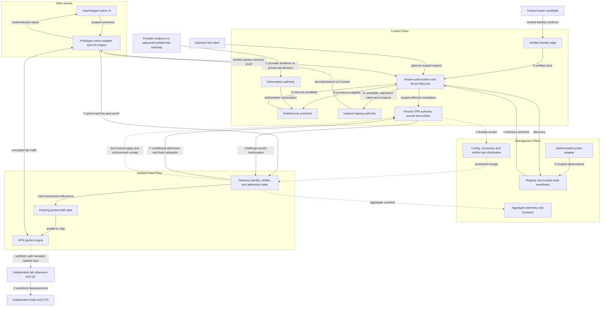

The lab fixture alternative feeds a private synthetic subscription authority. Its evidence cannot enter the real provider-ingestion interface. Gateway-to-Control traffic includes admission, activation, live authority challenges, renewal and reconciliation. The packet worker has no Identity, Billing or Hub dependency.

## 2. Login, verified actor and enrollment

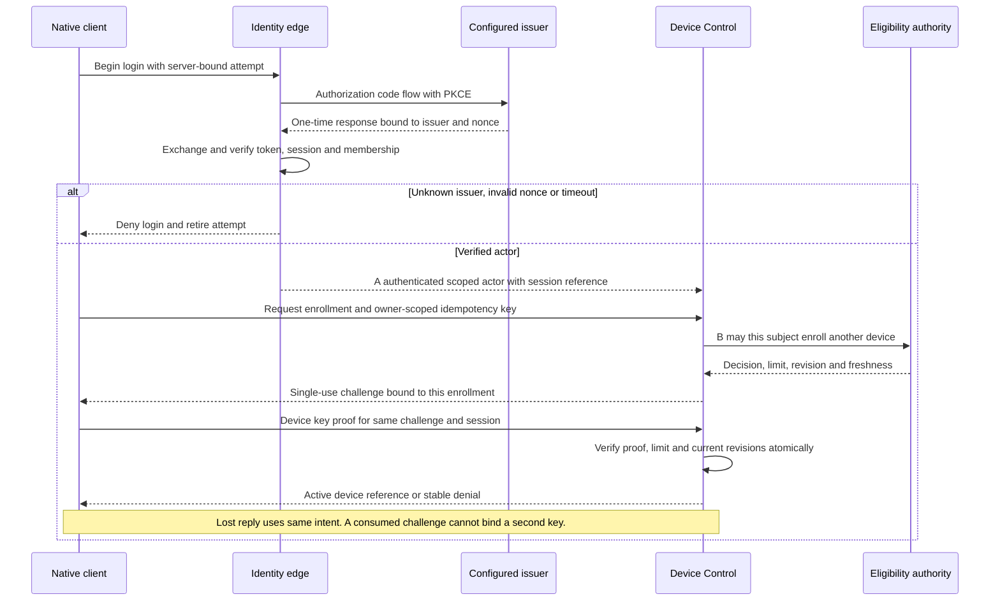

## 3. Eligibility, candidate and signing

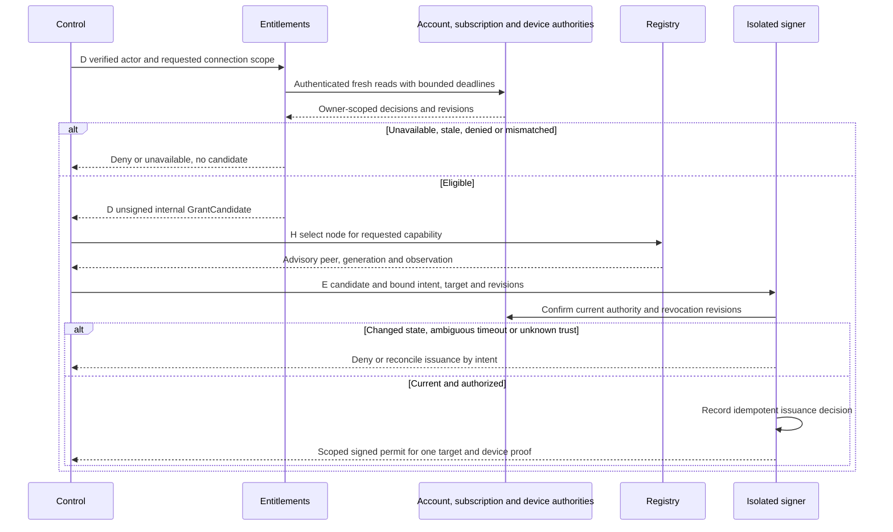

## 4. Selection, admission and tunnel evidence

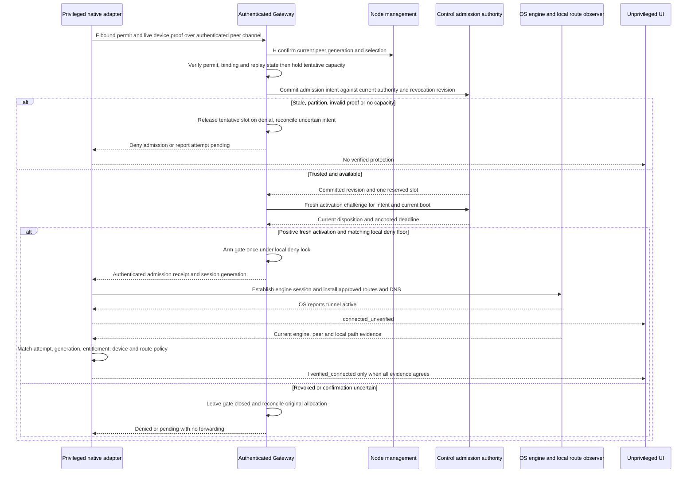

## 5. Renewal and rekey

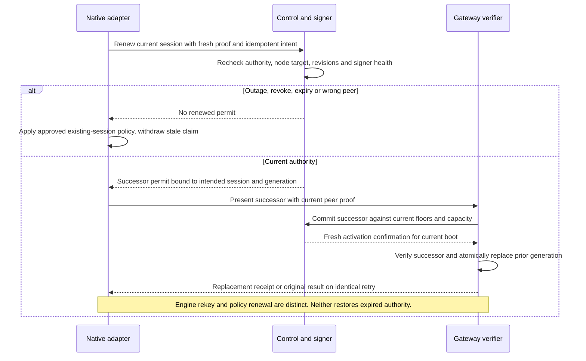

## 6. Revocation, asynchronous propagation and safe disconnect

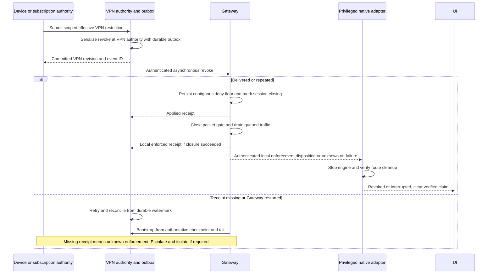

## 7. Network loss, restore or fail closed

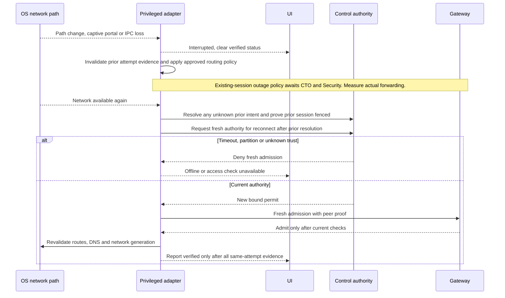

## 8. Dependency graph for the first laboratory connection

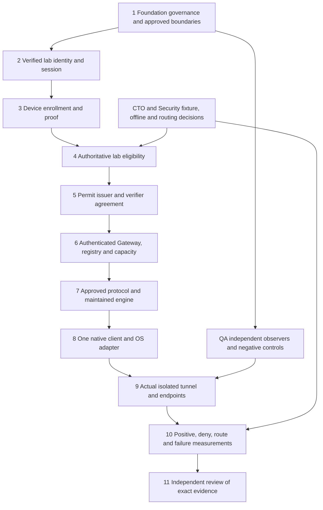

Stage 3 can prove device enrollment against an explicitly approved private enrollment decision. Stage 4 validates the separate right to connect. Run order, owners, gates, artifacts and cleanup are in the [lab migration plan](LAB_MIGRATION_AND_ACCEPTANCE.md).

## 9. Race at the authority and recovery of a lost commit reply

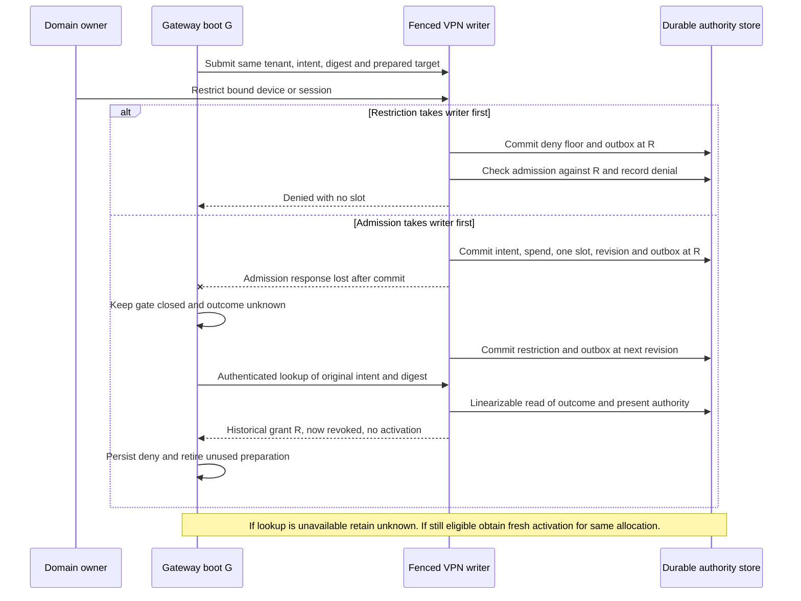

## 10. Active session during partition and independent cutoff evidence

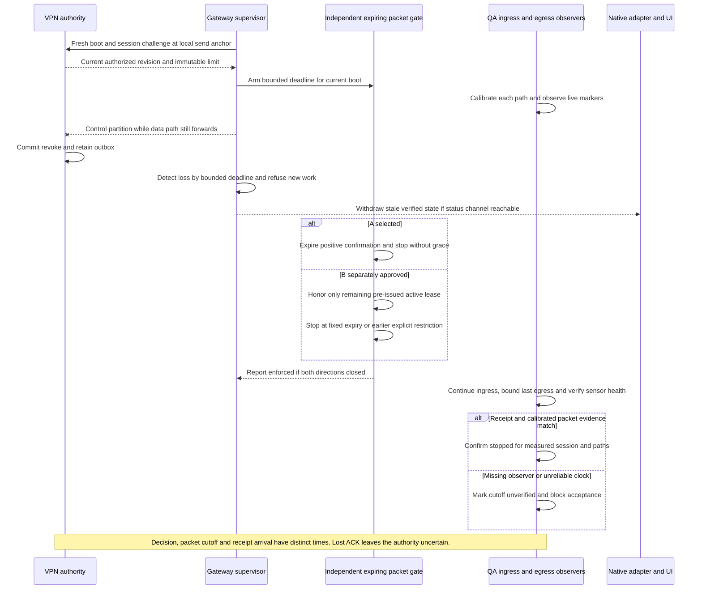

## 11. Restart, missing revisions and restored management

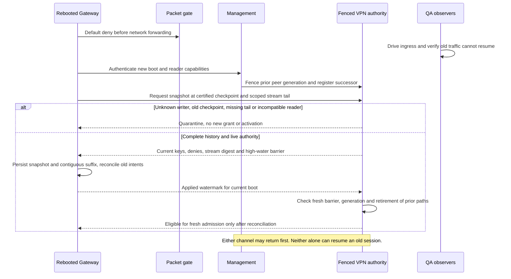
